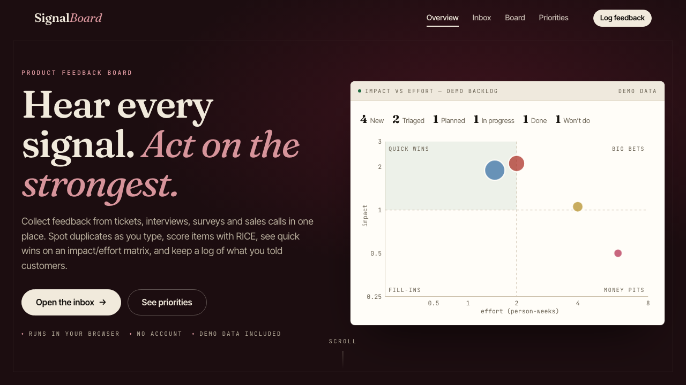
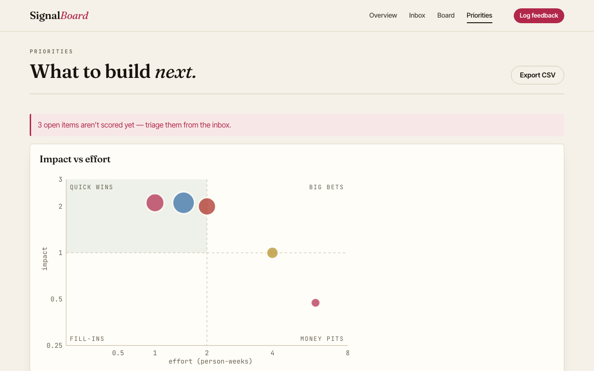
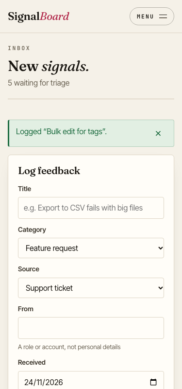

# Signal Board

A product feedback board: log feedback from tickets, interviews, surveys and sales calls, catch duplicates as you type, score items with RICE, see quick wins on an impact/effort matrix, move work across a status board, and record what you told customers.

**Live demo:** [https://signal-board.vercel.app/](https://signal-board.vercel.app/) — runs entirely in your browser; demo data is fictional and labelled.



| Priorities | Mobile |
| --- | --- |
|  |  |

## Run it

```bash
npm install
npm run dev        # http://localhost:5216
npm test
npm run build
npm run test:e2e   # Playwright smoke test (npm run e2e:install once if Chromium is missing)
```

## Main workflow

1. The app opens with ten labelled, fictional **feedback items** at every status, including a near-duplicate of an existing bug. **Inbox → Clear demo feedback** removes them.
2. **Inbox** → log feedback (title, category, source, who — a role, not personal details — date and a quote). While you type, similar existing items appear with **Add as a mention**, so repeated requests add weight instead of clutter.
3. **Triage** an item → set reach, impact, confidence and effort; the RICE score and quadrant update as you type. Change status and category, merge possible duplicates, and log replies to customers.
4. **Board** → six status columns ordered by RICE, with ←/→ buttons and a category filter.
5. **Priorities** → impact vs effort matrix (bubble size = RICE, legend by category, details on hover or focus) and a sortable table of open or all items; export CSV.

## Rules

- **RICE** = reach × impact × confidence ÷ effort. Impact uses 3 / 2 / 1 / 0.5 / 0.25; confidence 100% / 80% / 50%; effort in person-weeks (must be > 0).
- Quadrants: impact ≥ 1 is high, effort ≤ 2 weeks is low — quick win, big bet, fill-in or money pit.
- Similar items share meaningful title words (Jaccard similarity ≥ 25%, ignoring short and common words).
- Merging keeps the chosen item’s fields and combines mentions, replies and tags in date order. Saving a score moves a new item to Triaged.

## Design

Shared editorial system: Fraunces display type, Inter Tight interface text, category colours used for tags, card edges and bubbles, a highlighted quick-win quadrant, an ink hero whose preview is the real matrix, and a warm paper workspace. Motion is disabled under `prefers-reduced-motion`.

## Tests

- `src/lib/feedback.test.ts` — RICE, quadrants, open statuses, title similarity, similar-item ranking, merging, counts, CSV rows, validation.
- `src/App.test.tsx` — duplicate warning while typing and adding a mention, logging with validation, scoring and merging, moving on the board, RICE ranking and matrix.
- `e2e/smoke.spec.ts` — landing, log and score an item with reload persistence, merge, board, priorities, plus 375px layout checks.

## Limitations

- Single user, one browser; no integrations with support tools.
- Similarity matching is word-based, so differently worded duplicates can be missed.

## Future improvements

- Import from a CSV of support tickets; a public read-only roadmap view.

## Licence

MIT — see [LICENSE](LICENSE).
